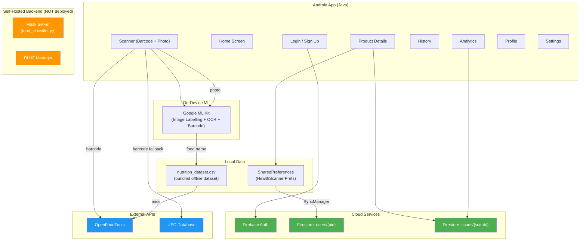
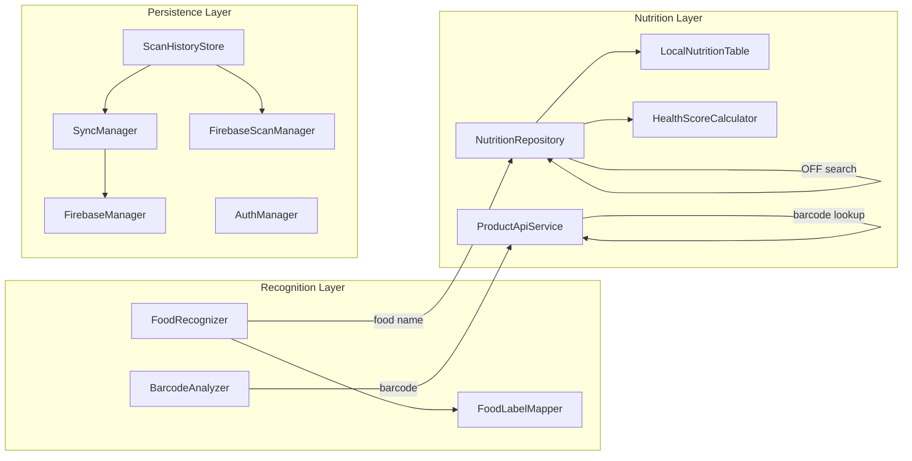
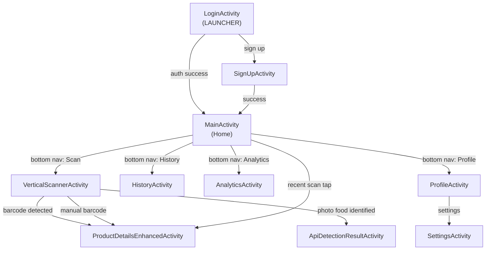
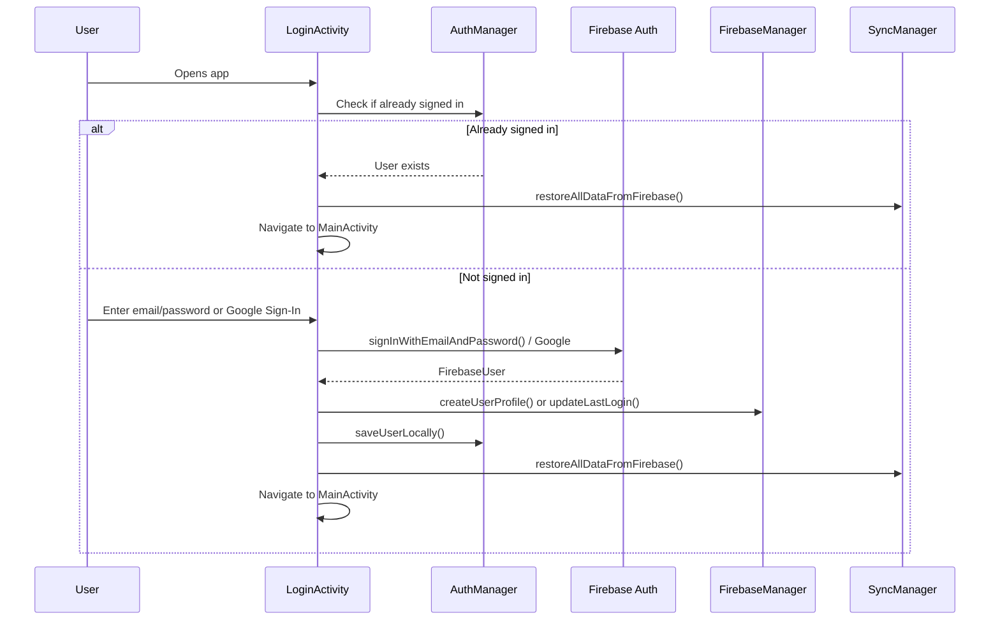
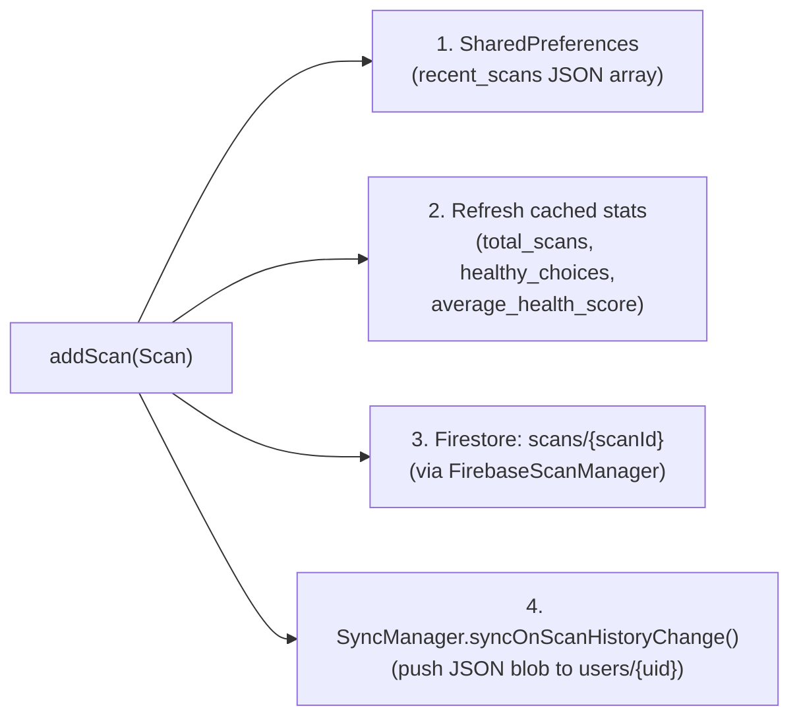
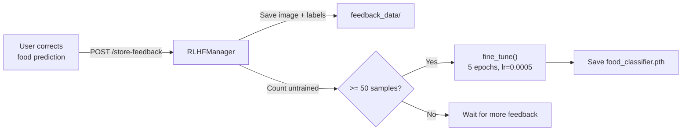

# Nure — System Architecture

> A brutally honest technical map of everything in this codebase: what works, what's duct-taped, and what's dead code.

---

## Table of Contents

- [1. High-Level Overview](#1-high-level-overview)
- [2. Component Architecture](#2-component-architecture)
- [3. Activity Map & Navigation](#3-activity-map--navigation)
- [4. Feature Deep-Dives](#4-feature-deep-dives)
  - [4.1 Authentication](#41-authentication)
  - [4.2 Barcode Scanning → Nutrition Lookup](#42-barcode-scanning--nutrition-lookup)
  - [4.3 Photo-Based Food Recognition → Nutrition Lookup](#43-photo-based-food-recognition--nutrition-lookup)
  - [4.4 Health Score Calculation](#44-health-score-calculation)
  - [4.5 Scan History & Persistence](#45-scan-history--persistence)
  - [4.6 Data Synchronisation (Local ↔ Cloud)](#46-data-synchronisation-local--cloud)
  - [4.7 Analytics Dashboard](#47-analytics-dashboard)
  - [4.8 Dark Mode / Theming](#48-dark-mode--theming)
  - [4.9 Backend ML Server (Python/Flask)](#49-backend-ml-server-pythonflask)
  - [4.10 RLHF Feedback Loop](#410-rlhf-feedback-loop)
- [5. Data Architecture](#5-data-architecture)
- [6. External APIs & Services](#6-external-apis--services)
- [7. Status Verdicts — What's Really Working](#7-status-verdicts--whats-really-working)
- [8. Known Architectural Problems](#8-known-architectural-problems)
- [9. File Index](#9-file-index)

---

## 1. High-Level Overview

Nure is an **Android app (Java, Material 3)** that lets users scan food — either by **barcode** or by **camera photo** — and shows nutritional information with a health score. Data is persisted locally in `SharedPreferences` and synced to **Firebase Cloud Firestore**. A separate **Python Flask backend** (not deployed — runs on a local machine) provides an ML-based food classifier with an RLHF retraining loop.



> [!IMPORTANT]
> The Python Flask backend (`backend/`) is **not currently used by the Android app at runtime**. The app's photo-recognition path was rewritten to use **on-device ML Kit** instead. The backend exists as a standalone project and for the RLHF demonstration in the presentation.

---

## 2. Component Architecture



| Layer | Responsibility | Key Classes |
|-------|---------------|-------------|
| **Recognition** | Identify what food is in the image or barcode | `FoodRecognizer`, `FoodLabelMapper`, `BarcodeAnalyzer`, `BarcodeScannerManager` |
| **Nutrition** | Turn a food name or barcode into nutrition facts + health score | `NutritionRepository`, `LocalNutritionTable`, `HealthScoreCalculator`, `ProductApiService` |
| **Persistence** | Store scans, sync to Firebase, manage auth | `ScanHistoryStore`, `SyncManager`, `FirebaseManager`, `FirebaseScanManager`, `AuthManager` |
| **UI** | Activities, adapters, animations | `MainActivity`, `VerticalScannerActivity`, `ProductDetailsEnhancedActivity`, etc. |

---

## 3. Activity Map & Navigation



| Activity | Purpose | Status |
|----------|---------|--------|
| `LoginActivity` | Email/password + Google Sign-In | ✅ Working |
| `SignUpActivity` | Email/password registration | ✅ Working |
| `MainActivity` | Home screen with recent scans, stats, tips | ✅ Working |
| `VerticalScannerActivity` | Camera scanner with barcode + photo modes | ✅ Working |
| `ProductDetailsEnhancedActivity` | Barcode product detail view | ✅ Working |
| `ApiDetectionResultActivity` | Photo recognition result view | ✅ Working |
| `HistoryActivity` | Scan history list | ✅ Working |
| `AnalyticsActivity` | Category breakdown, stats charts | ✅ Working |
| `ProfileActivity` | User profile, recent scans, saved products | ✅ Working |
| `SettingsActivity` | Dark mode, notifications, data management | ✅ Working |
| `ProductDetailsActivitySimple` | Simpler product view (legacy) | ⚠️ Legacy — not primary |
| `SimpleProductActivity` | Test/debug product view | ⚠️ Testing only |
| `ProductSelectionActivity` | RLHF food correction picker | ⚠️ Used with backend path only |
| `FirebaseTestActivity` | Debug Firebase connectivity | ⚠️ Debug only |

---

## 4. Feature Deep-Dives

### 4.1 Authentication



**Status: ✅ Fully Working**

- `AuthManager` wraps Firebase Auth, stores credentials locally in `SharedPreferences`
- Supports email/password + Google Sign-In
- On login, restores full user data from Firestore → local `SharedPreferences`

---

### 4.2 Barcode Scanning → Nutrition Lookup

```mermaid
sequenceDiagram
    participant U as User
    participant VS as VerticalScannerActivity
    participant BA as BarcodeAnalyzer
    participant PDE as ProductDetailsEnhancedActivity
    participant PAS as ProductApiService
    participant OFF as OpenFoodFacts
    participant UPC as UPC Database

    U->>VS: Point camera at barcode
    VS->>BA: Analyse camera frame (ML Kit)
    BA-->>VS: Barcode string detected
    VS->>PDE: Intent with barcode
    PDE->>PAS: fetchProductInfo(barcode)
    PAS->>OFF: GET /api/v0/product/{barcode}.json
    alt Found
        OFF-->>PAS: Product + nutriments
        PAS-->>PDE: ProductInfo with nutrition
    else Not found
        PAS->>UPC: GET /prod/trial/lookup?upc={barcode}
        alt Found
            UPC-->>PAS: Product name (NO nutrition data)
            PAS-->>PDE: ProductInfo (name only, score = 5.0)
        else Not found
            PAS-->>PDE: "Product not found in any database"
        end
    end
    PDE->>PDE: Display nutrition + health score
```

**Status: ✅ Working, but with caveats**

| Component | Verdict |
|-----------|---------|
| ML Kit barcode detection | ✅ Works on-device, no network needed |
| OpenFoodFacts lookup | ✅ Working — primary source, good coverage for packaged goods |
| UPC Database fallback | ⚠️ Working but **returns NO nutrition data** — only product name and brand |
| Nutritionix, Spoonacular, USDA, Edamam | ❌ **Placeholder only** — API keys are `"your_*_api_key"` strings, skipped at runtime |
| Health score (barcode path) | ⚠️ Uses `ProductApiService.calculateHealthScore()` — a **different** scoring model (0-10 scale) from the photo path's `HealthScoreCalculator` (0-100 scale) |

> [!WARNING]
> **Two different health score calculators exist:**
> - `ProductApiService.calculateHealthScore()` — used by the barcode path, returns 0-10 scale
> - `HealthScoreCalculator.calculate()` — used by the photo path and `ScanHistoryStore`, returns 0-100 scale
>
> This means the same food scanned by barcode vs. photo will get a different health score. The UI always displays it as if it's a 0-100 score.

---

### 4.3 Photo-Based Food Recognition → Nutrition Lookup

This is the most complex pipeline and was **rewritten** from the original design. The current working version does **NOT** use the Python backend.

```mermaid
sequenceDiagram
    participant U as User
    participant VS as VerticalScannerActivity
    participant FR as FoodRecognizer
    participant MLK as ML Kit (on-device)
    participant FLM as FoodLabelMapper
    participant NR as NutritionRepository
    participant LNT as LocalNutritionTable
    participant OFF as OpenFoodFacts Search
    participant AR as ApiDetectionResultActivity

    U->>VS: Tap capture in PRODUCT_DETECT mode
    VS->>VS: Take photo (CameraX ImageCapture)
    VS->>FR: recognize(bitmap)

    FR->>MLK: Image Labelling
    MLK-->>FR: Labels + confidences (e.g. "Pizza 0.82", "Food 0.95")

    FR->>FLM: rank(labels, confidences)
    FLM-->>FR: Outcome (best candidate or empty)

    alt Specific food identified
        FR-->>VS: Recognition("pizza", 0.82, IMAGE_LABEL)
    else No specific food, try OCR
        FR->>MLK: Text Recognition (OCR)
        MLK-->>FR: Text blocks from packaging
        FR->>FR: bestOcrTerm() — pick longest alphabetic line
        alt OCR found product name
            FR-->>VS: Recognition("product name", 0.5, OCR_TEXT)
        else Nothing found
            FR-->>VS: Recognition(null, 0, NONE)
            VS->>U: Prompt "What is this?" dialog
            U->>VS: Types food name
        end
    end

    VS->>NR: resolve(foodName)

    NR->>LNT: lookup(foodName) — offline CSV
    alt Found in CSV
        LNT-->>NR: Nutrition per 100g
        NR-->>VS: Resolution(LOCAL_DATASET)
    else Not in CSV
        NR->>OFF: GET search?q={foodName}
        alt Found with plausible nutrition
            OFF-->>NR: Product with nutriments
            NR->>NR: isPlausible() + relevanceScore() filter
            NR-->>VS: Resolution(OPEN_FOOD_FACTS)
        else Not found
            NR-->>VS: Resolution(NONE)
            VS->>U: Prompt "What is this?" dialog
        end
    end

    VS->>VS: Create Scan object, store via ScanHistoryStore
    VS->>AR: Launch with scan data
```

**Status: ✅ Working — this is the production path**

| Step | How it works | Verdict |
|------|-------------|---------|
| Image capture | CameraX `ImageCapture` | ✅ |
| Food recognition | ML Kit on-device image labelling | ✅ Works offline, decent for common foods |
| Label mapping | `food_labels.json` asset maps ML Kit labels → food names | ✅ Extensible without code changes |
| OCR fallback | ML Kit text recognition on the same image | ✅ Good for packaged food |
| Manual entry fallback | AlertDialog when nothing is identified | ✅ Good UX recovery |
| Offline nutrition | `nutrition_dataset.csv` (bundled) | ✅ Instant, covers ~100+ common foods |
| Online nutrition | OpenFoodFacts free-text search | ✅ No API key needed, broad coverage |
| Plausibility filter | Rejects impossible nutrition (>900 kcal/100g, etc.) | ✅ Prevents showing garbage data |
| Relevance filter | Token overlap check between query and result | ✅ Prevents "banana" → "Blue Bird Chips" |

> [!NOTE]
> **What happened to the Python backend?** The `FoodRecognizer` class comment explicitly says it *"replaces the previous bundled 28 MB `food_classifier.onnx`, which was an untrained network whose 100-class output was compared against label indices in the 924-963 range and therefore never produced a match."* The on-device ML Kit approach is now the actual working path.

---

### 4.4 Health Score Calculation

The **canonical** health score calculator is `HealthScoreCalculator.java`. It uses a 0-100 scale with weighted nutrient buckets:

| Nutrient | Max Points | Better when... |
|----------|-----------|----------------|
| Calories | 20 | Lower (≤100 → 20pts, >500 → 0pts) |
| Sugar | 20 | Lower (≤2g → 20pts, >20g → 0pts) |
| Fat | 15 | Lower (≤3g → 15pts, >20g → 0pts) |
| Protein | 15 | Higher (≥20g → 15pts, <2g → 0pts) |
| Fiber | 15 | Higher (≥10g → 15pts, <0.5g → 0pts) |
| Sodium | 15 | Lower (≤100mg → 15pts, >1500mg → 0pts) |

**Grade mapping:** A (≥85) → B (≥70) → C (≥55) → D (≥40) → E (<40)

**Status: ✅ Working, well-designed, unit-testable (no Android dependencies)**

> [!WARNING]
> The barcode path (`ProductApiService`) uses a **completely different** scoring formula (0-10 scale, additive adjustments from a base of 5.0). These two scoring systems are **inconsistent** and can produce contradictory grades for the same food.

---

### 4.5 Scan History & Persistence

`ScanHistoryStore` is the **single entry point** for all scan writes. When a scan is added:



**Status: ✅ Working — this was a recent consolidation**

Previously each activity wrote its own version of scan JSON with different field sets. `ScanHistoryStore` now standardises this.

> [!CAUTION]
> **Data is still stored in 4 places simultaneously:**
> 1. `SharedPreferences` → `recent_scans` (JSON array string, max 50 items)
> 2. Firestore → `users/{uid}` → `scanHistory` field (entire JSON blob as a string)
> 3. Firestore → `users/{uid}/scans` sub-collection (individual documents via `FirebaseManager.saveScanHistory()`)
> 4. Firestore → `scans/{scanId}` top-level collection (via `FirebaseScanManager.saveScan()`)
>
> Location #3 is populated by `FirebaseManager.saveScanHistory()` but it's unclear which code path currently calls it. Location #4 is now populated by `ScanHistoryStore.saveToFirestore()` and is what `AnalyticsActivity` reads from.

---

### 4.6 Data Synchronisation (Local ↔ Cloud)

```mermaid
flowchart TD
    subgraph "Local (Source of Truth)"
        SP["SharedPreferences<br/>(HealthScannerPrefs)"]
    end

    subgraph "Sync Triggers"
        T1["Scan added"]
        T2["Preferences changed"]
        T3["Profile updated"]
        T4["Auto-sync timer (1 min)"]
        T5["AutoSyncService"]
    end

    subgraph "Cloud"
        FS["Firestore: users/{uid}"]
    end

    T1 --> SM["SyncManager"]
    T2 --> SM
    T3 --> SM
    T4 --> SM
    T5 --> SM

    SM -->|collectAllUserData()| SP
    SM -->|backupAllUserData()| FS

    LOGIN["Login"] -->|restoreAllDataFromFirebase()| SM
    SM -->|restoreDataToLocal()| SP
```

**Status: ⚠️ Working but heavy-handed**

- Every sync operation (`syncOnScanHistoryChange`, `syncOnHealthPreferencesChange`, etc.) first syncs the specific data, then **also** runs `syncAllDataToFirebase()`, which re-uploads the entire user document every time
- Sync interval is 1 minute (`isSyncNeeded()` check)
- No conflict resolution — last-write-wins
- No delta/diff sync — full document merge every time

---

### 4.7 Analytics Dashboard

`AnalyticsActivity` reads from the **Firestore `scans` collection** (top-level) filtered by user ID.

**Status: ✅ Working** (now that `ScanHistoryStore` writes to the `scans` collection)

---

### 4.8 Dark Mode / Theming

**Status: ⚠️ Partially working, known issues**

- `DarkModeManager` stores preference in `HealthScannerPrefs` and calls `AppCompatDelegate.setDefaultNightMode()`
- `SettingsActivity` historically stored in a **separate** prefs file (`HealthScannerSettings`) — may still be disconnected
- Many layout XMLs have **hardcoded light-mode colors** (`#1B1B1B`, `#FFFFFF`, etc.) that don't adapt
- `values-night/colors.xml` exists but not all color tokens have dark overrides
- See [tasks/implementation.md](file:///e:/Projects/Nure/tasks/implementation.md) for the full fix plan

---

### 4.9 Backend ML Server (Python/Flask)

The `backend/` directory contains a fully functional Flask server with:

| File | Purpose |
|------|---------|
| [app.py](file:///e:/Projects/Nure/backend/app.py) | Flask routes: `/predict`, `/ocr-detect`, `/store-feedback`, `/retrain`, `/model-stats`, `/health` |
| [food_classifier.py](file:///e:/Projects/Nure/backend/food_classifier.py) | Custom CNN + MobileNetV2 ImageNet fallback, 100 food categories |
| [nutrition_db.py](file:///e:/Projects/Nure/backend/nutrition_db.py) | Hardcoded Python dict of ~30 Indian foods with nutrition data |
| [rlhf_manager.py](file:///e:/Projects/Nure/backend/rlhf_manager.py) | Feedback collection + fine-tuning pipeline |
| [food_categories.json](file:///e:/Projects/Nure/backend/food_categories.json) | 100 Indian + international food categories |

**Status: ❌ Not used in production / Not deployed**

The Android app was rewritten to use on-device ML Kit instead of calling this server. The key issues were:

1. **The Custom CNN has no pre-trained weights** — `food_classifier.pth` doesn't ship, so the model starts with random initialization and predicts randomly
2. **The ImageNet fallback mapping is arbitrary** — `IMAGENET_FOOD_MAP` maps class 924 (guacamole) → "gulab_jamun", class 951 (fig) → "mango", class 954 (strawberry) → "grapes"
3. **The backend IP is hardcoded** to a local network address (`10.126.145.199:5000`) in `ApiConfig.java` — not reachable outside the developer's WiFi
4. **`nutrition_db.py` only covers ~30 foods** — the app now uses a 100+ row CSV dataset + OpenFoodFacts search instead

The backend exists for:
- Presentation/demo purposes (the RLHF story)
- Future potential if the model is properly trained and deployed

> [!CAUTION]
> The `.onnx` model bundled in `app/src/main/assets/food_classifier.onnx` (28MB) is an **untrained export** of the Custom CNN. It was part of the original design where the app would run inference locally via ONNX Runtime, but it was **never functional**. The app no longer references it; `FoodRecognizer` uses ML Kit instead. This file is dead weight in the APK.

---

### 4.10 RLHF Feedback Loop



**Status: ⚠️ Functional code, but effectively dead**

- The code is well-structured and would work if the model were trained
- Currently only 9 feedback images exist in `feedback_data/images/`
- The 50-sample threshold for retraining has never been reached
- The Android app no longer sends feedback to this server (it uses on-device ML Kit)
- If ever activated, corrections weight 2x in training (reward shaping)

---

## 5. Data Architecture

### SharedPreferences (`HealthScannerPrefs`)

| Key | Type | Used by |
|-----|------|---------|
| `recent_scans` | JSON string (array) | `ScanHistoryStore`, `SyncManager`, `MainActivity`, `HistoryActivity` |
| `total_scans` | int | Home screen stats card |
| `healthy_choices` | int | Home screen stats card |
| `average_health_score` | float | Home screen stats card |
| `current_user_email` | string | Profile, sync |
| `current_user_name` | string | Profile, home greeting |
| `current_user_id` | string | Firebase operations |
| `current_user_photo` | string | Profile avatar |
| `auth_provider` | string | Profile display |
| `dark_mode_enabled` | boolean | `DarkModeManager` |
| `notifications_enabled` | boolean | Settings |
| `health_concerns` | StringSet | Profile, sync |
| `dietary_preferences` | StringSet | Profile, sync |
| `last_sync_timestamp` | long | `SyncManager` auto-sync |
| `login_timestamp` | long | Profile "member since" |
| `join_date_timestamp` | long | Profile "member since" |
| `is_first_launch_after_signin` | boolean | First-time restore trigger |

### Firestore: `users/{uid}`

Single document per user containing: profile fields, scan statistics, the entire `scanHistory` as a JSON string, health preferences, sync metadata. See [database_and_api_overview.md](file:///e:/Projects/Nure/database_and_api_overview.md) for full schema.

### Firestore: `scans/{scanId}`

One document per scan. Used by `AnalyticsActivity` to query category breakdowns. Written by `ScanHistoryStore` → `FirebaseScanManager.saveScan()`.

### Bundled Assets

| Asset | Size | Purpose |
|-------|------|---------|
| `nutrition_dataset.csv` | ~100+ rows | Offline nutrition for common foods (Tier 1 lookup) |
| `food_labels.json` | Small | Maps ML Kit label text → canonical food names |
| `food_categories.json` | Small | 100 food categories for the backend classifier (not used by app) |
| `food_classifier.onnx` | ~28 MB | **Dead weight** — untrained ONNX model, never loaded |
| `imagenet_food_map.json` | Small | ImageNet class → food name mapping for backend (not used by app) |

---

## 6. External APIs & Services

| Service | Used for | Auth | Status |
|---------|----------|------|--------|
| **Firebase Auth** | Email/password + Google Sign-In | google-services.json | ✅ **Working** |
| **Cloud Firestore** | User profiles, scan data, sync | google-services.json | ✅ **Working** |
| **Google ML Kit (Barcode)** | On-device barcode detection | None (bundled) | ✅ **Working** |
| **Google ML Kit (Image Labelling)** | On-device food recognition | None (bundled) | ✅ **Working** |
| **Google ML Kit (Text Recognition)** | OCR for packaging text | None (bundled) | ✅ **Working** |
| **OpenFoodFacts API** | Barcode → product + nutrition | None (free) | ✅ **Working** |
| **OpenFoodFacts Search** | Food name → nutrition | None (free) | ✅ **Working** |
| **UPC Database** | Barcode → product name | None (trial) | ⚠️ **Working but no nutrition data** |
| **Nutritionix** | Barcode → nutrition | API key needed | ❌ **Placeholder — key not configured** |
| **Spoonacular** | Barcode → nutrition | API key needed | ❌ **Placeholder — key not configured** |
| **USDA FoodData Central** | Food search → nutrition | API key needed | ❌ **Placeholder — key not configured** |
| **Edamam** | Food search → nutrition | API key needed | ❌ **Placeholder — key not configured** |
| **Nure ML Server** | Food image → classification | Local network | ❌ **Not deployed / not used by app** |

---

## 7. Status Verdicts — What's Really Working

### ✅ Genuinely Working (Production-Ready)

| Feature | Evidence |
|---------|----------|
| Firebase Auth (email + Google) | `AuthManager` + `LoginActivity` fully wired |
| Barcode scanning (ML Kit) | On-device, instant, no network |
| Barcode → nutrition via OpenFoodFacts | Primary API, free, good coverage |
| Photo → food name via ML Kit labels | On-device labelling + `FoodLabelMapper` |
| OCR fallback for packaged food | ML Kit text recognition, good recovery |
| Manual food name entry | AlertDialog prompt when recognition fails |
| Offline nutrition lookup | `nutrition_dataset.csv` via `LocalNutritionTable` |
| Online nutrition lookup | OpenFoodFacts search with plausibility + relevance filtering |
| Health score (0-100, photo path) | `HealthScoreCalculator` — deterministic, testable |
| Scan history (local + cloud) | `ScanHistoryStore` → `SharedPreferences` + Firestore |
| Data sync to Firebase | `SyncManager` push on every change |
| Data restore on login | Full restore from Firestore → local |

### ⚠️ Working but with Issues

| Feature | Issue |
|---------|-------|
| Barcode health score | Uses different 0-10 scale calculator (`ProductApiService`) |
| UPC Database fallback | Returns name only, no nutrition — health score defaults to 5.0/10 |
| Dark mode | Toggle works but many UI elements have hardcoded light colors |
| Auto-sync | Overly aggressive (re-syncs entire document), no conflict resolution |
| Data duplication | Scan data lives in 4 Firestore locations |
| Scan history cap | Only 50 most recent kept locally; older ones only in Firestore blob |

### ❌ Not Working / Dead Code

| Feature | Reason |
|---------|--------|
| Python Flask backend | Not deployed; hardcoded to local IP; model untrained |
| RLHF feedback loop | Server not reachable; only 9 feedback samples collected |
| `food_classifier.onnx` | 28MB dead asset — untrained, never loaded |
| Nutritionix / Spoonacular / USDA / Edamam APIs | Placeholder keys `"your_*_api_key"` |
| `ImageNet food map` in backend | Arbitrary mappings (fig → mango, strawberry → grapes) |
| `ProductSelectionActivity` | Was for RLHF correction; orphaned from current flow |
| `SimpleProductActivity` | Test activity, not in any user flow |
| `FirebaseTestActivity` | Debug activity |

---

## 8. Known Architectural Problems

### 🔴 Critical

1. **Dual health score systems** — `ProductApiService` (0-10) vs `HealthScoreCalculator` (0-100). The barcode path and photo path produce incomparable scores displayed on the same scale in the UI.

2. **28MB dead asset** — `food_classifier.onnx` ships in every APK but is never used. Removing it would halve the APK size.

3. **Backend IP hardcoded** — `ApiConfig.NURE_BASE_URL = "http://10.126.145.199:5000"` is a local network IP. If the backend path is ever re-enabled, it will silently fail on any other network.

### 🟡 Moderate

4. **Scan data duplication** — 4 storage locations with no single source of truth on the cloud side. `SharedPreferences` is the local source of truth, but the 3 Firestore locations can diverge.

5. **Full-document sync** — Every sync pushes the entire user document. No delta tracking, no timestamps per field. Last write wins, so two devices editing simultaneously will lose data.

6. **No offline queue** — If Firebase is unreachable when a scan is saved, the Firestore write fails silently (logged only). The local copy survives, but the next full sync may or may not pick it up.

7. **Dark mode incomplete** — Hardcoded colors in ~15 layout files and ~11 drawables. See the full remediation plan in [tasks/implementation.md](file:///e:/Projects/Nure/tasks/implementation.md).

### 🟢 Minor

8. **`SettingsActivity` prefs file** — May still write to `HealthScannerSettings` instead of `HealthScannerPrefs` for some settings, causing disconnection from `DarkModeManager`.

9. **Gallery barcode scanning** — Opens a system picker; the user can select any image. If it's not a barcode, the error message is generic.

10. **Report says "web application"** — The academic report and abstract repeatedly describe Nure as a "web application" but it's actually a native Android app.

---

## 9. File Index

### Android App (Java)

| File | Lines | Role |
|------|-------|------|
| [ApiConfig.java](file:///e:/Projects/Nure/app/src/main/java/com/example/healthscanner/ApiConfig.java) | 82 | API URLs and keys (mostly placeholder) |
| [AuthManager.java](file:///e:/Projects/Nure/app/src/main/java/com/example/healthscanner/AuthManager.java) | 501 | Firebase Auth wrapper |
| [FoodRecognizer.java](file:///e:/Projects/Nure/app/src/main/java/com/example/healthscanner/FoodRecognizer.java) | 260 | ML Kit image labelling + OCR → food name |
| [FoodLabelMapper.java](file:///e:/Projects/Nure/app/src/main/java/com/example/healthscanner/FoodLabelMapper.java) | 253 | Maps ML Kit labels to canonical food names |
| [NutritionRepository.java](file:///e:/Projects/Nure/app/src/main/java/com/example/healthscanner/NutritionRepository.java) | 609 | Tiered nutrition lookup (CSV → USDA → OFF) |
| [LocalNutritionTable.java](file:///e:/Projects/Nure/app/src/main/java/com/example/healthscanner/LocalNutritionTable.java) | 211 | Offline CSV nutrition with fuzzy matching |
| [HealthScoreCalculator.java](file:///e:/Projects/Nure/app/src/main/java/com/example/healthscanner/HealthScoreCalculator.java) | 191 | 0-100 health score, A-E grades |
| [ProductApiService.java](file:///e:/Projects/Nure/app/src/main/java/com/example/healthscanner/ProductApiService.java) | 467 | Cascading barcode API lookup |
| [VerticalScannerActivity.java](file:///e:/Projects/Nure/app/src/main/java/com/example/healthscanner/VerticalScannerActivity.java) | 723 | Camera scanner (barcode + photo modes) |
| [ScanHistoryStore.java](file:///e:/Projects/Nure/app/src/main/java/com/example/healthscanner/database/ScanHistoryStore.java) | 289 | Centralised scan persistence |
| [SyncManager.java](file:///e:/Projects/Nure/app/src/main/java/com/example/healthscanner/database/SyncManager.java) | 433 | Local ↔ Firebase sync orchestrator |
| [FirebaseManager.java](file:///e:/Projects/Nure/app/src/main/java/com/example/healthscanner/database/FirebaseManager.java) | 614 | Firestore CRUD for user documents |
| [FirebaseScanManager.java](file:///e:/Projects/Nure/app/src/main/java/com/example/healthscanner/database/FirebaseScanManager.java) | 362 | Firestore CRUD for `scans` collection |
| [MainActivity.java](file:///e:/Projects/Nure/app/src/main/java/com/example/healthscanner/MainActivity.java) | 1132 | Home screen |
| [LoginActivity.java](file:///e:/Projects/Nure/app/src/main/java/com/example/healthscanner/LoginActivity.java) | 1662 | Login + onboarding |
| [ProfileActivity.java](file:///e:/Projects/Nure/app/src/main/java/com/example/healthscanner/ProfileActivity.java) | 970 | User profile |

### Backend (Python)

| File | Lines | Role |
|------|-------|------|
| [app.py](file:///e:/Projects/Nure/backend/app.py) | 204 | Flask routes |
| [food_classifier.py](file:///e:/Projects/Nure/backend/food_classifier.py) | 302 | Custom CNN + MobileNetV2 |
| [nutrition_db.py](file:///e:/Projects/Nure/backend/nutrition_db.py) | 220 | Hardcoded nutrition dictionary |
| [rlhf_manager.py](file:///e:/Projects/Nure/backend/rlhf_manager.py) | 185 | RLHF feedback + retraining |

### Documentation

| File | Purpose |
|------|---------|
| [README.md](file:///e:/Projects/Nure/README.md) | Project overview (outdated) |
| [database_and_api_overview.md](file:///e:/Projects/Nure/database_and_api_overview.md) | Database schemas + API status |
| [presentation.md](file:///e:/Projects/Nure/presentation.md) | Academic presentation slides |
| [report.md](file:///e:/Projects/Nure/report.md) | Full academic project report |
| [tasks/implementation.md](file:///e:/Projects/Nure/tasks/implementation.md) | Dark mode implementation plan |

---

> *Last updated: 2026-11-20. This document reflects the actual state of the codebase, not the aspirational state described in the academic report.*
